# Infraestructura 1 - Seguridad de Redes con FortiGate

## Video demostrativo

[Ver video en YouTube](https://www.youtube.com/watch?v=j444FvV504I)

## Propósito del laboratorio

Segmentar una red empresarial con un FortiGate, separando usuarios (VLAN 10 y VLAN 20), servidores (DMZ) y salida a Internet, y aplicando políticas que controlen el acceso entre zonas: qué VLAN puede usar SSH, qué VLAN puede ver el servidor de inventario, y que la DMZ no pueda iniciar conexiones hacia la LAN ni navegar libremente por Internet.

## Topología GNS3

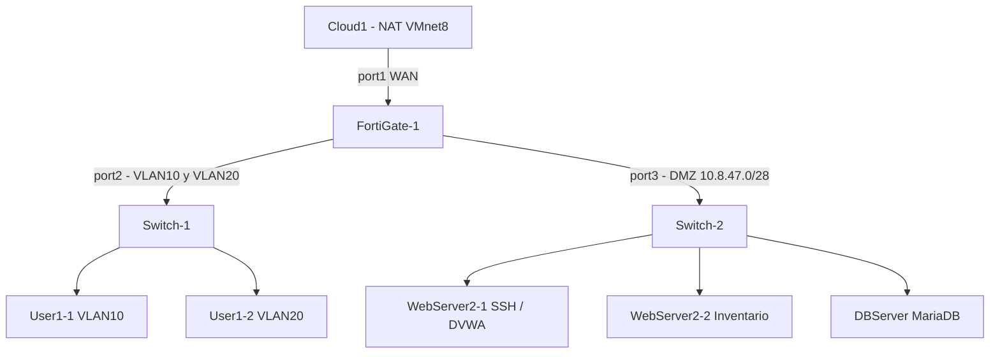

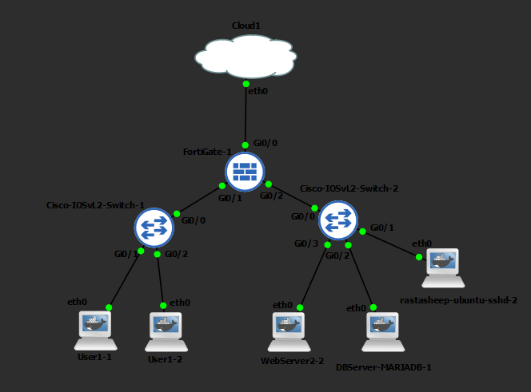

### Plan de direccionamiento

Base: 10.8.46.0 (matrícula 20250846).

| Segmento | Red | Gateway | Rango de hosts |
|---|---|---|---|
| VLAN 10 (usuarios) | 10.8.46.0/25 | 10.8.46.1 | .2 a .126 |
| VLAN 20 (usuarios) | 10.8.46.128/25 | 10.8.46.129 | .130 a .254 |
| DMZ (servidores) | 10.8.47.0/28 | 10.8.47.1 | .2 a .14 |

| Equipo | IP |
|---|---|
| User1-1 | 10.8.46.2 |
| User1-2 | 10.8.46.130 |
| WebServer2-1 (SSH) | 10.8.47.2 |
| WebServer2-2 (Inventario) | 10.8.47.3 |
| DBServer-MARIADB-1 | 10.8.47.4 |

## Configuración

- **Switch-1:** VLAN 10 (Gi0/1), VLAN 20 (Gi0/2), trunk 802.1q en Gi0/0 hacia el FortiGate.
- **Switch-2:** puertos de servidores en VLAN 1 (access), Gi0/0 hacia el FortiGate.
- **FortiGate:** port1 WAN (DHCP), port2 con subinterfaces VLAN10 y VLAN20 con DHCP, port3 DMZ.

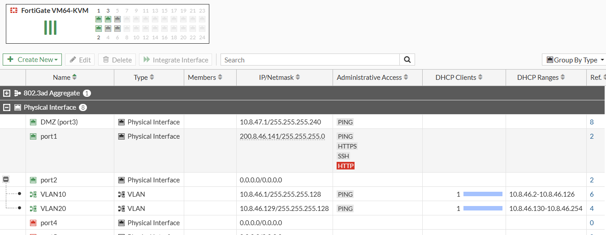

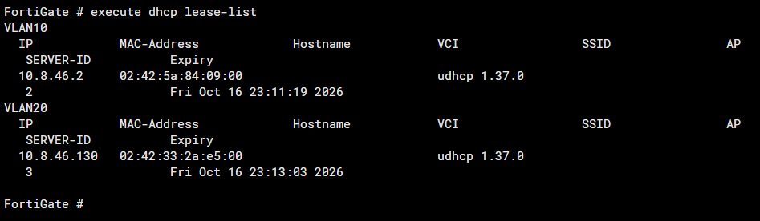

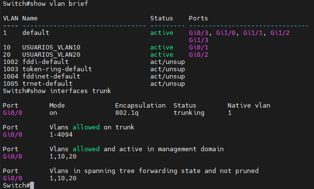

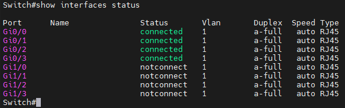

### Objetos

- `DMZ_SERVERS`: 10.8.47.0/28
- `Web_Inventario`: 10.8.47.3/32
- `updates_ubuntu`: FQDN de repositorios Ubuntu
- `GOOGLE_DNS`: 8.8.8.8/32

## Políticas (en orden)

**VLAN 10 → DMZ**

| Política | Origen | Destino | Servicio | Acción |
|---|---|---|---|---|
| VLAN10_BLOQUEO_INVENTARIO | all | Web_Inventario | ALL | DENY |
| VLAN10_SSH_DENY | all | DMZ_SERVERS | SSH | DENY |
| VLAN10_ICMP | all | DMZ_SERVERS | ALL_ICMP | ACCEPT |

**VLAN 20 → DMZ**

| Política | Origen | Destino | Servicio | Acción |
|---|---|---|---|---|
| VLAN20_SSH | all | DMZ_SERVERS | SSH | ACCEPT |

**DMZ → LAN**

| Política | Origen | Destino | Acción |
|---|---|---|---|
| DMZ_LAN_DENY | DMZ_SERVERS | all (VLAN10) | DENY |
| DMZ_LAN_DENY_2 | DMZ_SERVERS | all (VLAN20) | DENY |

**DMZ → Internet**

| Política | Destino | Servicio | Acción |
|---|---|---|---|
| DMZ_UPDATES (NAT) | updates_ubuntu, GOOGLE_DNS | HTTP, HTTPS, DNS | ACCEPT |
| DMZ_INTERNET | all | ALL | DENY |

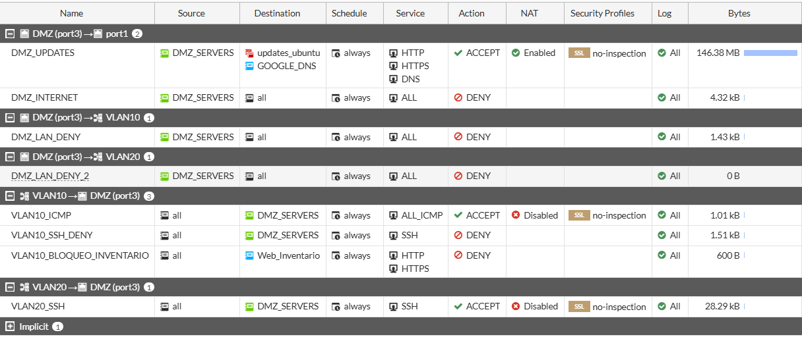

| Política | Captura |
|---|---|
| VLAN10_BLOQUEO_INVENTARIO | 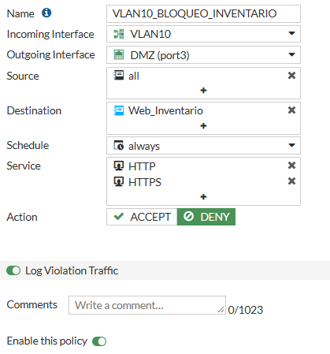 |
| VLAN10_ICMP | 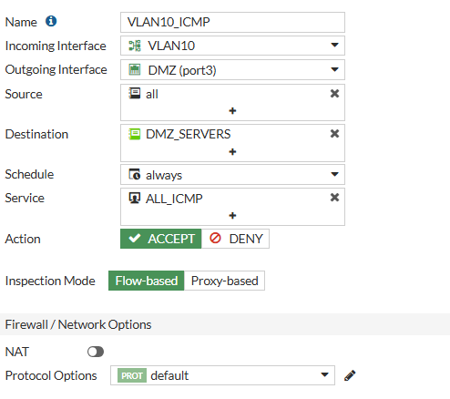 |
| VLAN10_SSH_DENY | 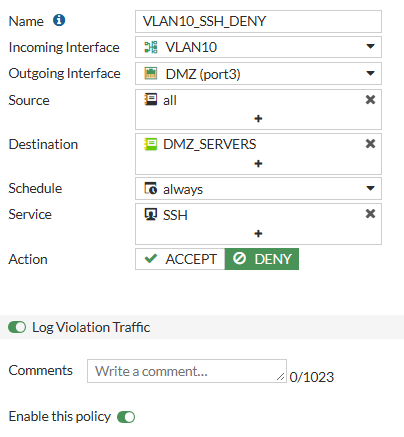 |
| VLAN20_SSH | 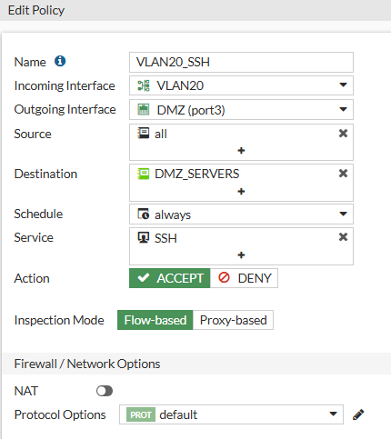 |
| DMZ_UPDATES | 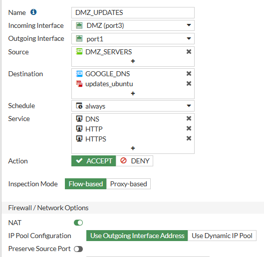 |
| DMZ_INTERNET | 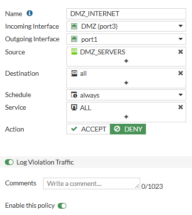 |
| DMZ_LAN_DENY | 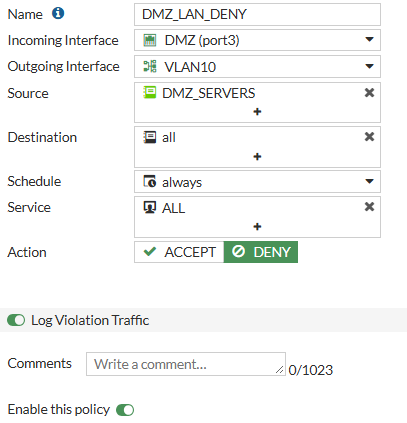 |
| DMZ_LAN_DENY_2 | 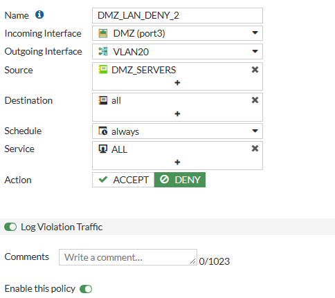 |

## Pruebas y resultados

### Usuarios

Desde User1-1 (VLAN 10): el ping a la DMZ responde, SSH y curl a Inventario son bloqueados y quedan registrados.

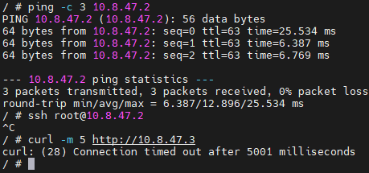

Desde User1-2 (VLAN 20): SSH a WebServer2-1 conecta.

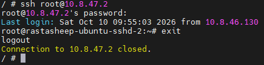

### Servidor en la DMZ

Desde WebServer2-1: ping a 8.8.8.8 bloqueado, ping a User1-1 bloqueado, `apt-get update` a los repositorios permitido.

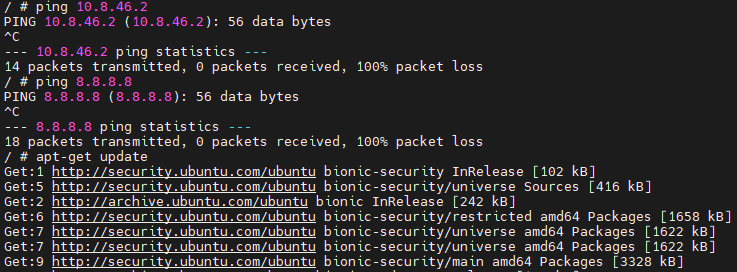

### Logs

VLAN 10 hacia la DMZ (ping, SSH y curl):

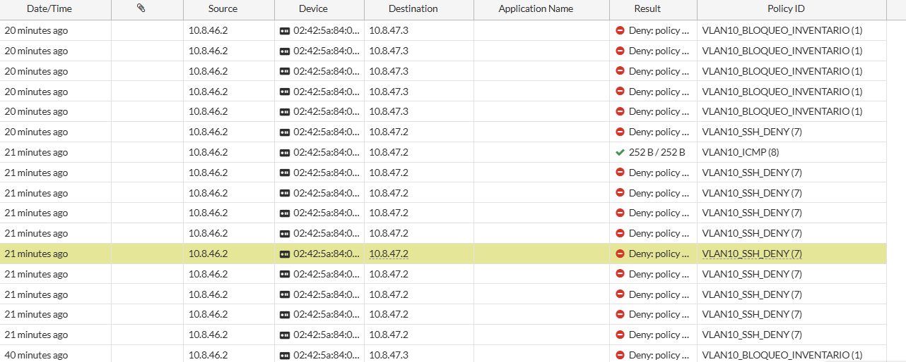

DMZ hacia LAN e Internet:

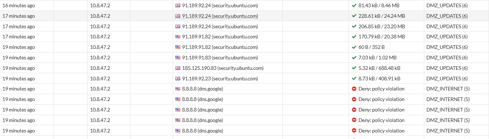

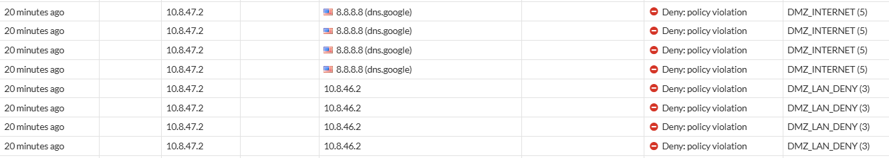

## Scripts

Los comandos de configuración de IP de los equipos finales y otros scripts están en [`scripts`](scripts).

## Running-configs

Los comandos de configuración de IP de los equipos finales están en [`configs`](configs).
